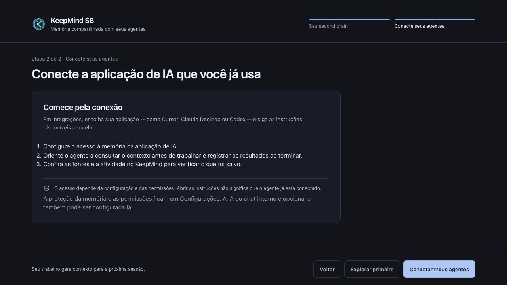
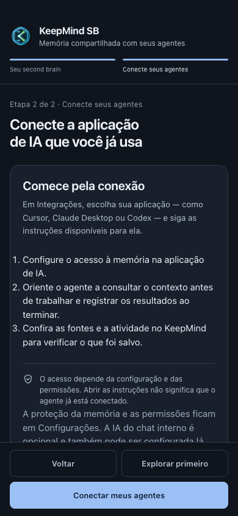
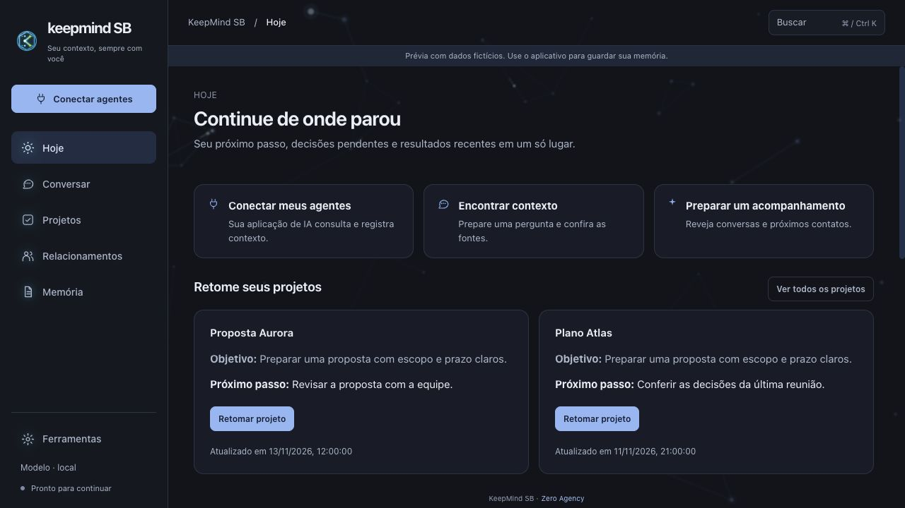

# Agent-first onboarding and installed SB validation

2026-11-13. Baseline: `5aade2bbd37ec2aaccb89e56b254fee05573686e`, published SB 0.2.6.

## Product correction

KeepMind SB is shared context for agents in the user's AI application. The primary onboarding action now opens agent integration instructions. It neither configures the internal chat provider nor requires a manual note/password. Today and the personal desktop/compact navigation prioritize connections; memory empty states explain agent-generated context. Manual capture remains an optional utility accessible from Memory and its existing shortcut.

Opening instructions does **not** establish or verify a connection. Existing MCP/GitHub configuration, encryption, authorization and recovery remain enforced. Protection is configured through Settings. Removing it from onboarding does not unlock a vault or migrate data. Internal chat AI remains optional in Settings.

## Installed native app

Tested a disposable copy of the installed app, with matching `app.asar` SHA-256 `76afdfc16c459c7ece6004e5795ca28d6bacfcf9ab1a7349814ba9668a42813e`. Main-process assertions verified the effective temporary user-data directory before inputs. Synthetic account, project and encrypted source only. Keychain storage was replaced with an in-memory test store; OS Keychain integration was not tested.

Observed through macOS accessibility/UI automation:

- Invalid login rejected; valid synthetic login opened Today. Found raw Electron IPC error text on invalid credentials. Fixed with a Portuguese actionable alert and retry regression test.
- Today → resume project retained objective, next step and accepted decision.
- Project → source opened the full original synthetic source with path and history warning.
- Returning to Projects retained the selected project. Resume context → use in conversation prepared a draft without sending it to an AI provider.
- Native navigation responded without observed stalls. No FPS benchmark or long-session performance claim.

Isolation limitation: before the fixed-profile launcher was installed, macOS launched the test copy twice without its intended profile arguments. Both were stopped before clicks/typing. No personal content was intentionally edited, but those launches may have updated caches; byte-for-byte preservation of the personal profile is **not** claimed. Subsequent inputs were confined to the verified disposable profile. The installed app bundle was not modified by these tests.

## Changed renderer validation

- Build and TypeScript passed.
- Vitest: 305 passed, 2 existing skips.
- Existing `npm run test:experience` extended, 11 journeys passed: navigation, draft/error/retry, project resume, full source, answer source, reduced motion/avatar preference, keyboard focus, responsive onboarding and actual onboarding-to-integrations route.
- Header/footer/action visibility checked at 1440×900, 1024×640 and 390×844. Rendered preview inspected visually through CUA; compact screenshot reviewed separately. Main content scrolls; actions remain reachable.
- Security component tests still require recovery acknowledgement and preserve credentials after an unlock failure. No crypto gate removed.
- Corp brain build/selfcheck, CRM browser batch and release gate/report checks passed.
- Jev advisory review (`jev-1.14.0`, 1879 input/78 output tokens) found agent-first focus and honest instruction-vs-connection wording, each choice probability 1.0. This is not proof of functionality; report retained.

An initial smoke run used the old built renderer; rebuilt before successful rerun. An older app test expected the removed primary Capture button; updated to exercise the retained capture shortcut. No production AI connection, real credentials, email, or external agent writes were tested. New changes were validated in the renderer, not installed over the user's application.

## Reproduce

Reuse the existing batch rather than a new runner:

```sh
npm run build
npm run typecheck
TMPDIR=/private/tmp npm test
npm run test:experience
npm run corp:build-brain
npm run corp:check
TMPDIR=/private/tmp npm run test:crm-browser
node scripts/check-release-gates.mjs --reports
```

Aggregate report: [experience-report.json](evidence/agent-first/experience-report.json).





## Default neural background (PR #22 follow-up)

Neurons are enabled by default for profiles without a saved background preference. An explicit saved opt-out is preserved. Rendering is capped at 30 fps (including 120 Hz displays), with at most 96 neurons and 20 simultaneous pulses. Slower drift/pulses, clamped activity boost and 34% canvas opacity keep decoration subordinate to text/cards. Neighbor recomputation runs at most once per 600 ms. Hidden documents pause the loop; reduced motion or disabling the background removes it and releases the frame/resize work.

Validation: build/typecheck passed; 307 unit tests passed, two existing skips. The extended experience batch passed 12 journeys, including actual canvas content changing, non-intercepting pointer events, navigation with animation enabled, and canvas removal under system reduced motion. A deterministic 120 Hz simulation asserts no more than 30 canvas draws per second, pause/resume and cleanup. Visual review of the synthetic Today renderer confirmed visible, subdued neurons and readable cards. This is not a hardware FPS/battery benchmark; no change was installed into the user's personal app/profile.


